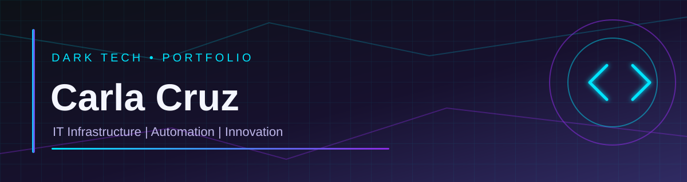

<!-- Perfil GitHub • CahCruz | Dark Tech -->

# Olá, eu sou a Carla Cruz 👩‍💻

---

## 🚀 Sobre mim

Sou profissional de **Tecnologia da Informação**, com experiência em ambientes corporativos, infraestrutura, suporte e administração de sistemas. Trabalho com a investigação de problemas, a identificação de inconsistências e a busca por soluções que tornem os processos mais eficientes.

- 🖥️ **Infraestrutura:** redes, servidores, virtualização e VMware ESXi.
- 🗄️ **Dados e ERP:** Oracle, MySQL, SQL, PL/SQL e ERP Sankhya.
- ⚙️ **Automação:** Python, scripts, integrações e otimização de processos.
- 💻 **Desenvolvimento:** aplicações e ferramentas voltadas a necessidades reais.
- 🤖 **Inteligência Artificial:** exploração de LLMs, Ollama e IA executada localmente.
- 🧠 **Mentalidade:** aprender continuamente, conectar conhecimentos e transformar ideias em resultados.

`DARK TECH` · `INFRASTRUCTURE` · `DATABASES` · `AUTOMATION` · `DEVELOPMENT` · `AI`

## ⚡ Tecnologias & Ferramentas

### 💻 Desenvolvimento e automação

### 🖥️ Infraestrutura e sistemas

 

### 🗄️ Bancos de dados e ERP

### 🤖 Inteligência artificial

---

## 🛠️ Áreas de atuação e interesse

| Área | Conhecimentos e aplicações |
| :--- | :--- |
| 🖥️ **Infraestrutura** | Servidores, redes, VMware ESXi e virtualização |
| 🗄️ **Banco de dados** | Oracle, MySQL, SQL e PL/SQL |
| 🏢 **ERP** | Sankhya, regras de negócio e integrações |
| ⚙️ **Automação** | Python, scripts e otimização de processos |
| 🤖 **Inteligência Artificial** | Ollama, LLMs e aplicações de IA local |
| 💻 **Desenvolvimento** | Aplicações, ferramentas e integração de sistemas |

---

## 📊 Meu GitHub em números

> **Nota:** os cartões dependem de serviços externos e podem ficar temporariamente indisponíveis. As linguagens exibidas representam repositórios analisados, não necessariamente o nível de domínio em cada tecnologia.

---

## 📁 Projetos em destaque

Estou organizando meus projetos de **infraestrutura, automação, bancos de dados, desenvolvimento e inteligência artificial** para compartilhar soluções e aprendizados.

🔎 **[Explorar meus repositórios](https://github.com/CahCruz?tab=repositories)**

<!-- Substitua esta seção por links e descrições dos projetos reais quando estiverem publicados. -->

---

## 🌐 Vamos nos conectar?

---

### ✨ Filosofia

*“A tecnologia não está apenas em escrever código, mas em encontrar maneiras melhores de resolver problemas.”*

**Sempre aprendendo · Sempre evoluindo · Sempre construindo**

